# Product review — September 2026

A product-manager pass over every screen, taken against the live library. The question
asked: what to add, tweak, or remove so the app is as good as possible at its two jobs —
tagging **where** a photo was taken and **who** is in it.

Screenshots were captured from the running app at 1400×900 (headless Chrome, so map tiles
are sometimes half-loaded). They show real library data.

## 1. Where the library stands

Numbers from the Home dashboard, because they decide what the app should be optimised for:

| Metric | Value |
|---|---|
| Photos | 107,785 (107,561 images, 224 videos) |
| Geotagged | 73,985 (69%) · 691 ignored · **33,109 remaining** |
| Undated | **9,266** |
| Photos with a nearby-in-time guess available | 1,972 |
| Faces | 173,728 detected · 59,981 labeled · 106,051 ignored · **0 unlabeled** |
| People | 444 people · 18 families |

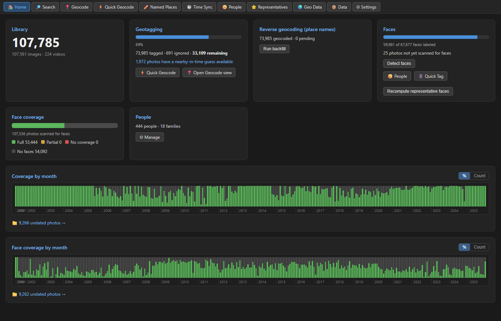

Two conclusions follow:

1. **The face-labeling backlog is finished.** The People page's bulk-triage tooling
   (Unlabeled queue, Discover clusters, Crowds, Quick Tag) has done its job. Quick Tag
   already opens on "All caught up". The face workflow now shifts to *intake* (new photos)
   and *trust* (auditing what was labeled).
2. **Geotagging is the remaining backlog**, and it is the hard third: photos with no GPS,
   often no time neighbours (scans), and 9K with no date at all. The tools that got the
   library to 69% (drag-to-map, propose bar, month picker) are not the tools that will get
   it to 95%.

The app is, in short, tuned for a phase that is over. The recommendations below re-aim it.

## 2. Screen-by-screen notes

### Home

Strong "mission control": progress bars, coverage-by-month histograms, deep links. What it
does not do is *tell the user what to do next*. It reports "1,972 photos have a
nearby-in-time guess" and "33,109 remaining" but offers no ranked list of batches. See
[Work queue](#31-work-queue-on-home).

### Geocode (main tool)

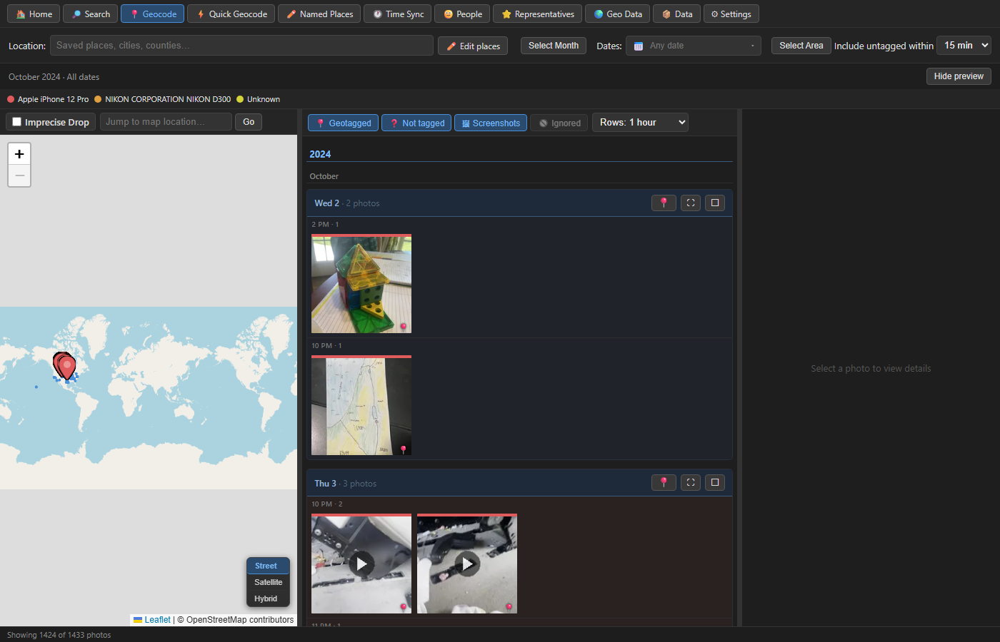

The best screen in the app. Staging + commit, the propose bar (`POST /api/geotag/propose`),
the two-level month picker with coverage bars, the `l` shortcut into the named-places
picker, imprecise drops with an accuracy radius, per-day pins — all good decisions.

Gaps:

- **No keyboard grid navigation.** People has `j`/`k`/space/`a`/`x` with a `?` help
  overlay; Geocode has only `l` and Esc. The grid is a keyboard job.
- **Tagged and untagged photos mix in the grid.** When the goal is tagging, tagged photos
  are noise. The "Not tagged" filter exists but is not remembered.
- **No folder facet.** Scanned photos cluster by folder ("1985 Box"), not by time. The
  uncommitted diff adds a "Folder, then date" sort to *People*; Geocode has nothing
  equivalent. "Tag this whole folder at Grandma's house" is the single most valuable move
  for the pre-GPS backlog.
- **Detail pane** has no prev/next, and faces are hidden behind a button to another page.
  Who is in the photo is a location hint ("Grandma → Grandma's house").
- **Street search lives on the Data page**, not here. Typing "Elm St" into "Jump to map
  location" is a core tagging move, not data management.
- Selecting a photo zooms the map to it. Right for tagged photos; for untagged ones the
  more useful view is its time-neighbours (which `showDayOnMap` does, but only on demand).

### Quick Geocode

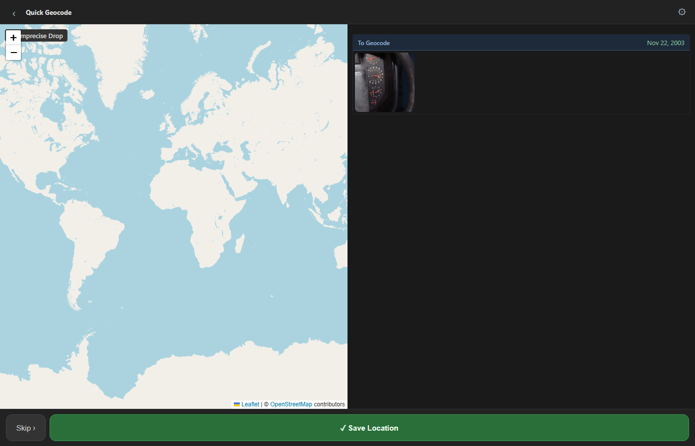

The right idea — "here is the next untagged group, with tagged photos before and after
it" — but the execution undercuts it. On this library it opens on a single 2003 dashboard
photo with no before/after context and a world map at zoom 2. Specifically:

- Starts at the oldest photo, where context is thinnest, rather than at the biggest or
  easiest batch.
- "Skip" is not persisted, so every visit replays the same skips from the top.
- No ignore, no propose bar, no named-places picker, no staging, no keyboard.
- `get_next_geotag_group` fetches *every* ungeotagged photo on each call and walks it
  in Python; fine at 33K, but the grouping (1-day window) is also the crudest in the app.

This page and Geocode are two tools for one job, with Geocode strictly better except for
the "give me the next group" button. Recommendation: fold that button into Geocode and
retire this page (or, if a mobile-friendly stripped page is wanted, rebuild it on
Geocode's staging/propose code paths).

### Search

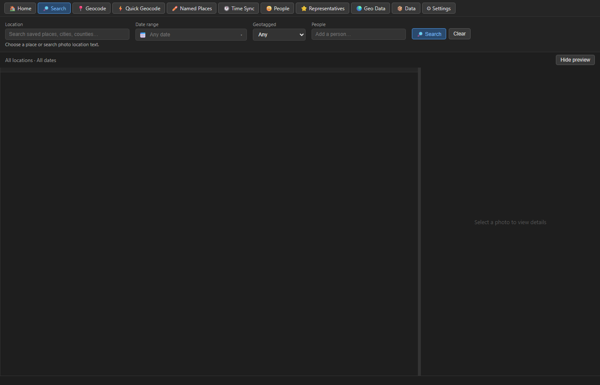

Good multi-facet search (saved places, date range, geotag status, people incl. "together").
Missing facets that matter for *tagging* work: camera, folder, GPS accuracy, has-faces.
No sort control. No handoff: "Open these in Geocode" or "Open these in People" would turn
Search into the selection tool for every other page.

### Named Places

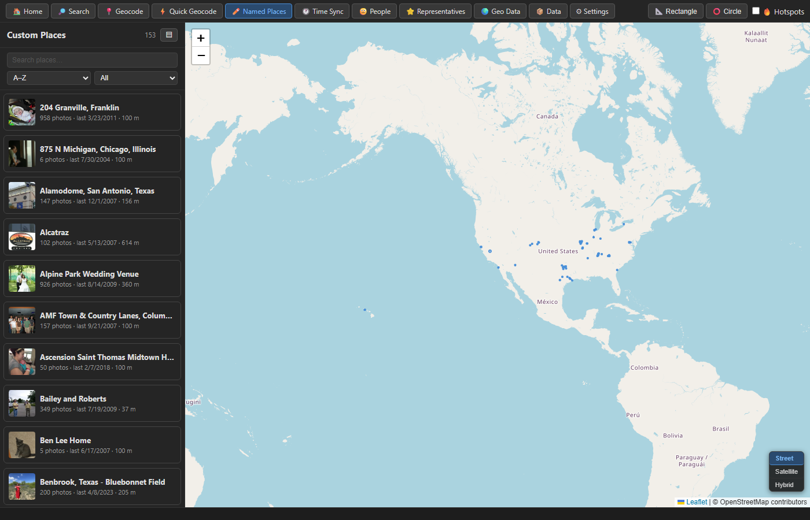

153 saved places with radius, representative thumbnail, count and last-used date. Solid.
Two additions would make it earn its nav slot: an *untagged photos likely here* count per
place (photos within the radius by time-neighbour inference), and *suggest a new place*
when the propose bar keeps landing on a coordinate that has no name yet.

### Time Sync

Does one thing (apply a fixed offset to a camera's clock) and does it clearly. But 9,266
undated photos need a *date assignment* tool, not an *offset* tool — see
[Undated photos](#34-undated-photos-need-a-date-tool).

### People

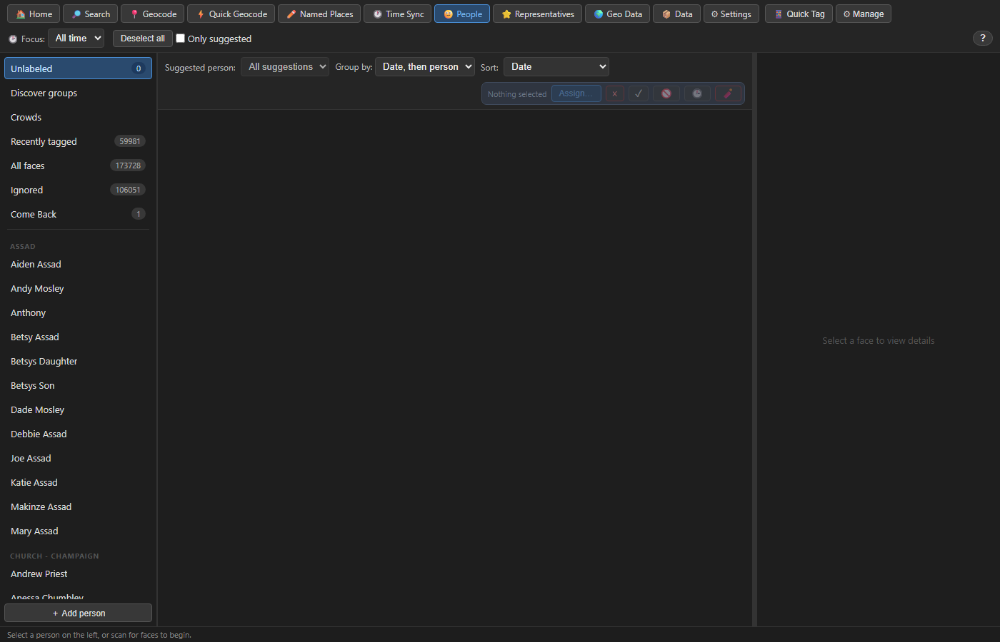

The largest subsystem and it shows: scopes, focus year, group-by, sort, staging, keyboard
shortcuts, a resizable detail pane, negative examples with undo. With the Unlabeled queue
at zero, what is missing is the *post-labeling* toolset:

- **Least-confident labels.** Faces were bulk-accepted at the 0.5 pre-select score.
  There is no view of "labels that least resemble this person's representatives". That
  is where the mislabels are.
- **Merge people.** The list contains near-duplicate names (Colin/Collin, Sue/Susan,
  a person and "X's Mom"). No merge action, no fuzzy duplicate detector.
- **Un-ignore sweep.** 106K faces are ignored, many from early in labeling when the
  gallery was thin. A one-shot "restore ignored faces that now match a known person
  above 0.6" would recover labels for free.
- "New since last scan" scope — the steady-state intake view.

### Representatives

Diagnostic: lets you inspect the medoid dedup that feeds matching. Useful for tuning,
not for tagging. Should live under an Admin/Advanced grouping rather than top nav.

### Geo Data (Places DB map)

Diagnostic overlay of OSM/Census/ZCTA polygons plus the click-to-probe popup. Excellent
for debugging *why* a photo got a city name; not a tagging tool. Same treatment as
Representatives.

### Data

Dataset downloads plus street search. Clear copy. Two additions: a **Backup database**
button (the `.geotagger` DB holds every face label, which has no sidecar export) and a
**Re-resolve place names for a region** action with a dry-run diff — today that is only
`scripts/regeocode.py`.

### Settings

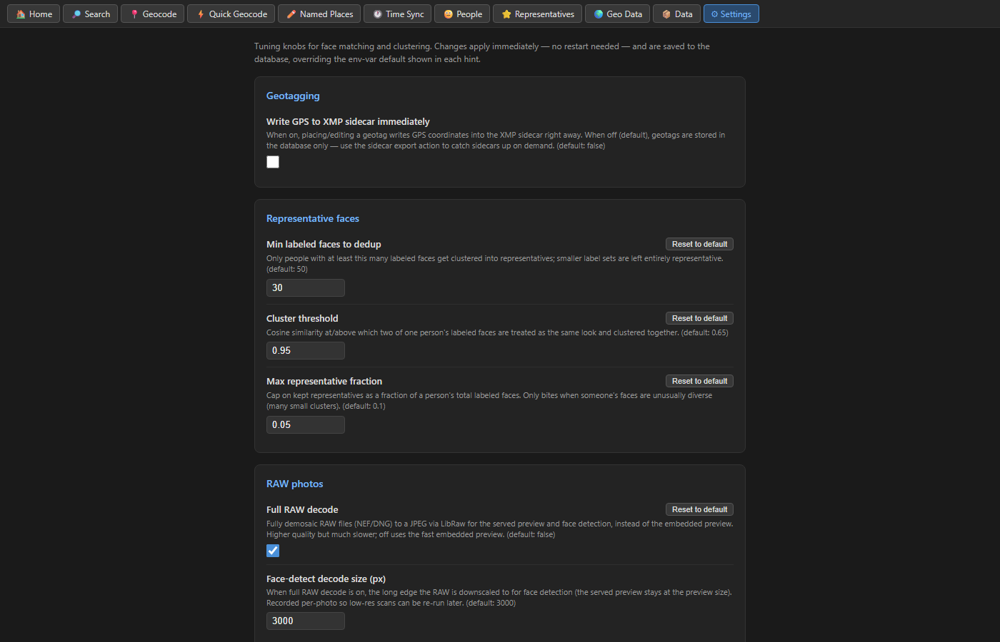

Twenty tunables, nineteen of them cosine thresholds and caps. Only *Write GPS to XMP
sidecar immediately* matters to normal use. Collapse the rest under "Advanced".

### Hidden pages (Quick Tag, Photo Faces, People Manager)

Quick Tag is done ("All caught up"). Photo Faces is good and should be reachable inline
from the Geocode detail pane. People Manager needs a thumbnail column and the merge
action above.

## 3. Recommendations

Ordered by impact on the actual remaining work.

### 3.1 Work queue on Home

Replace "33,109 remaining" with a ranked list of *batches* the user can knock out in one
decision each. Ranking = photos per decision, using data the app already has:

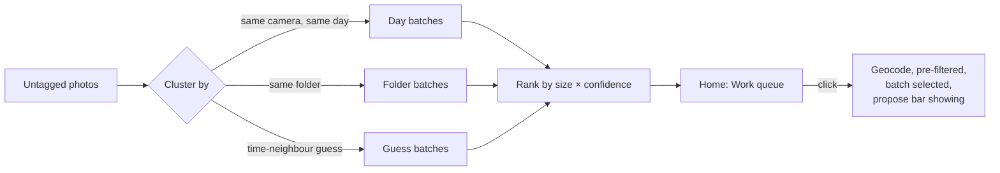

A card would read like: *"Oct 12 2024 · Nikon D300 · 1,060 photos · 3 tagged neighbours
at Alpine Park Wedding Venue"*. On this library that single row is 3% of the backlog.
Biggest-first turns 33K photos into a few hundred decisions.

### 3.2 Fold Quick Geocode into Geocode

Add a **Next untagged batch** button to Geocode that loads the top work-queue item. It
inherits staging, propose, named places, ignore, `l`, and (after 3.5) keyboard nav for
free. Retire `quick-geocode.html`. If a phone-sized page is still wanted, build it on the
same code, not a parallel implementation.

### 3.3 Batch guess review

`GET /api/guess/{photo_id}` is one photo at a time from the detail pane. 1,972 photos
already have a guess. Give them the same treatment faces got:

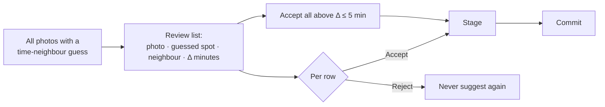

Same accept / accept-all / reject shape the user already knows from the face suggestion
queue.

### 3.4 Undated photos need a date tool

Time Sync applies an offset; 9,266 photos have nothing to offset. Scans arrive by folder
with no EXIF date. Add **Assign approximate date** to a folder or selection: year or
month precision, stored with a precision flag so the histogram and age-aware face
matching can treat it honestly. Pair it with a folder facet on Geocode so the same
selection can be geotagged in the same sitting.

### 3.5 Keyboard parity on Geocode

Port the People shortcut set: `j`/`k` move, space select, shift-extend, `l` tag as,
`i` ignore, `g` guess, Enter commit staged, `?` help. Remember the "Not tagged" filter
per session so the grid opens in tagging mode.

### 3.6 Export state tracking

Today `POST /api/geocode/export-sidecars` rewrites every geocoded photo's sidecar (74K)
because nothing records what changed since the last export. The DB stores
`sidecar_mtime` but no dirty flag.

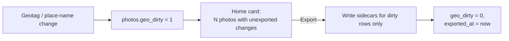

Two migration-safe columns, one filtered export, one Home card.

**Person names in sidecars.** Face tags are DB-only by an earlier decision (export
deferred). That decision was right while labels were churning. They are not churning any
more: 0 unlabeled, 60K labels. Writing `Iptc4xmpExt:PersonInImage` plus MWG face regions
is now the single biggest step in getting value *out* of the app — it is what Lightroom,
digiKam and Immich read. Worth re-deciding.

### 3.7 Trust and audit views

Nothing checks work already done. Two cheap views on existing indexes:

- **Geotag outliers** — same camera, same day, one photo more than N km from its
  siblings. Uses the same time-window join the propose bar uses.
- **Least-confident face labels** — per person, labels with the lowest cosine similarity
  to that person's representatives. Sort ascending, review the top hundred.

Plus **Merge people** with a fuzzy duplicate-name check in People Manager.

### 3.8 Undo history

Staging protects against mistakes *before* commit. After commit there is nothing: one
"Stage all at X" on a thousand photos, committed, has no way back. Add a `geotag_history`
table (photo, old lat/lng, new lat/lng, source, timestamp) and a **Recent changes** view
with revert. Faces already carry `assigned_at`; surface it the same way.

### 3.9 Steady-state intake

Scanning runs only at startup. The recurring workflow after import is:
import → geotag the photos without GPS → confirm face suggestions. Today that is three
pages and a restart.

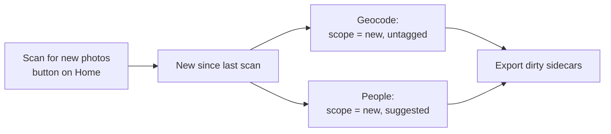

A "new since last scan" scope on both Geocode and People, and a scan button that does not
need a restart.

### 3.10 Navigation

Eleven top-nav items plus three hidden pages; the bar wraps to two lines below about
1,000 px. Four of the eleven are diagnostics or admin.

```mermaid
flowchart TB
    subgraph Today
        direction LR
        h1[Home] --- s1[Search] --- g1[Geocode] --- q1[Quick Geocode] --- n1[Named Places] --- t1[Time Sync] --- p1[People] --- r1[Representatives] --- m1[Geo Data] --- d1[Data] --- x1[Settings]
    end
    subgraph Proposed
        direction LR
        H[Home] --- TAG[Tag ▾\nGeocode · People] --- BR[Browse ▾\nSearch · Named Places] --- FIX[Fix ▾\nTime Sync · Dates · Audit] --- ADM[Admin ▾\nData · Geo Data · Representatives · Settings]
    end
```

Quick Geocode disappears into Geocode (3.2). Photo Faces becomes an inline panel.

## 4. Remove or de-emphasise

| Item | Action | Why |
|---|---|---|
| Quick Geocode page | Fold into Geocode | Weaker duplicate of the main tool |
| Representatives (top nav) | Move to Admin | Tuning diagnostic, not a tagging task |
| Geo Data (top nav) | Move to Admin | Debugging aid for place-name resolution |
| Settings: 19 threshold knobs | Collapse under Advanced | One toggle matters day to day |
| Road Trip | Keep off nav (already disabled) | Right idea for pre-GPS trips; ship when propose-along-route works |
| Quick Tag | Keep hidden | Done its job; still useful for intake on a phone |

## 5. Suggested order

1. Work queue on Home (3.1) and Next-batch button in Geocode (3.2) — same feature, two
   entry points. Changes how every session starts.
2. Batch guess review (3.3) — 1,972 photos, mostly one-click.
3. Keyboard parity and remembered filters on Geocode (3.5) — small, felt every minute.
4. Folder facet plus approximate-date tool (3.4) — unlocks the scans.
5. Dirty-flag export (3.6) — then re-decide person-name export.
6. Audit views and undo history (3.7, 3.8).
7. Intake scope and scan button (3.9), nav regroup (3.10).

## Appendix: remaining screenshots

| | |
|---|---|
| 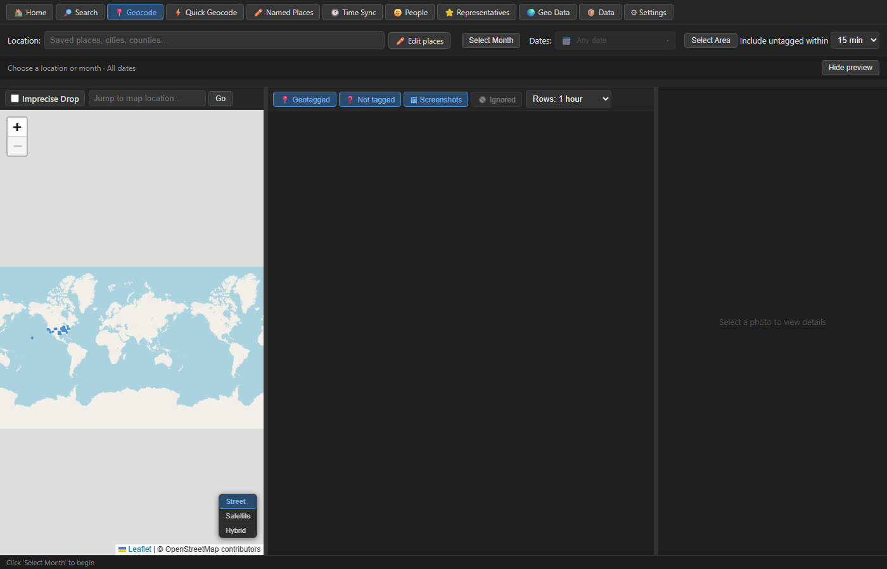 | 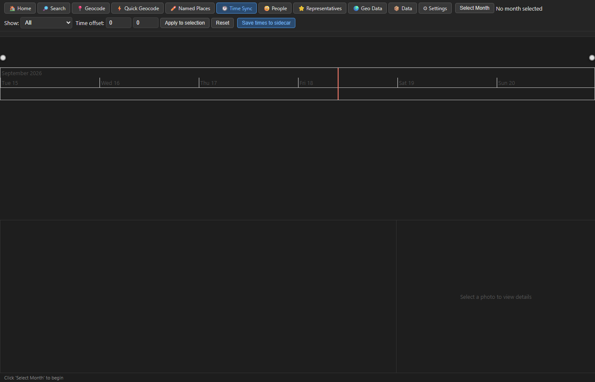 |
| 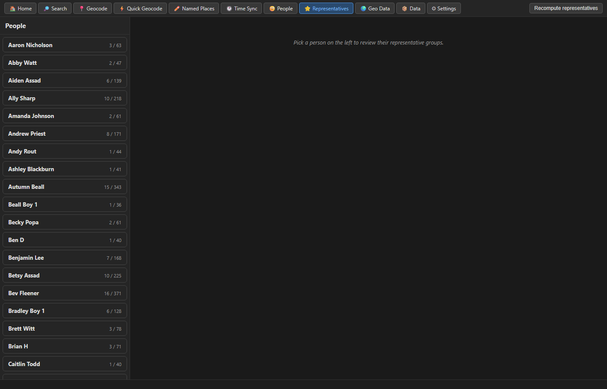 | 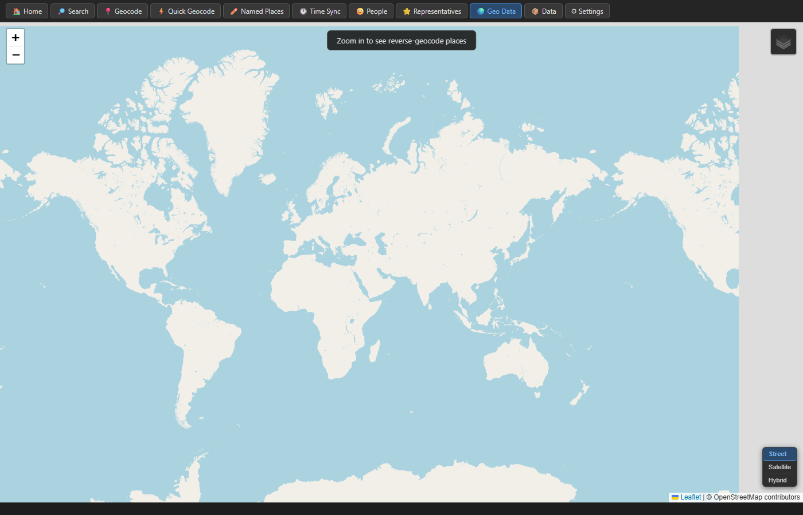 |
| 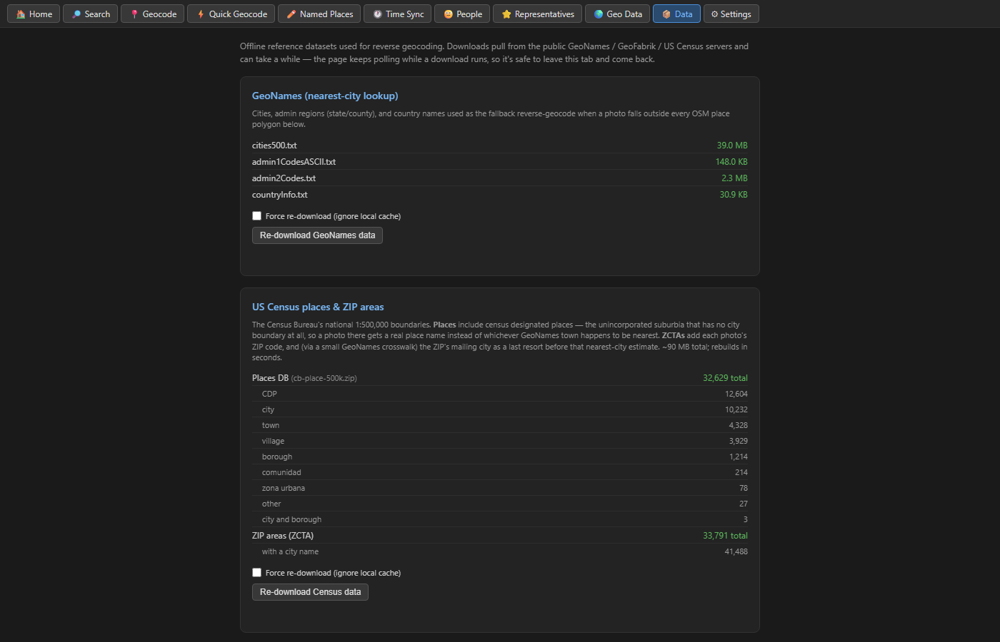 | 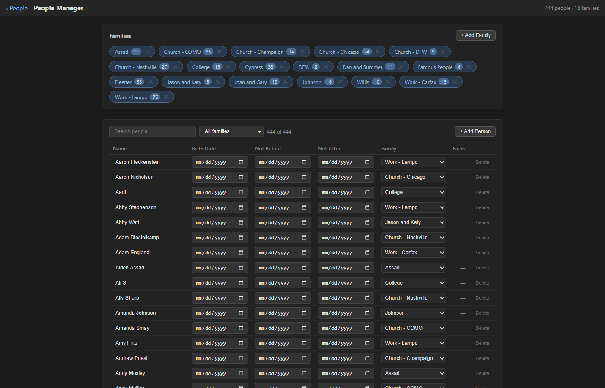 |
