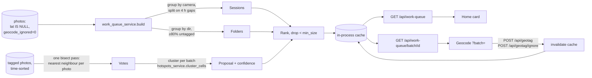

# Work Queue — plan

Companion to [PRODUCT_REVIEW.md](PRODUCT_REVIEW.md) §3.1–3.2. Self-contained: everything
needed to implement is here.

## 1. Goal

Turn "33,109 untagged photos" into a ranked list of **batches**, each one decision. The user
opens Home, sees the biggest/easiest batch first, clicks it, lands in Geocode with those
photos already selected and a proposed location already showing, and commits. Then clicks
**Next batch**. Repeat.

Non-goals for v1: undated photos that share no folder (nothing to batch on), face-based
location hints, changing how staging/commit works.

## 2. What a batch is

Two kinds. Both are computed, never stored — a batch is a *view* over untagged photos and
disappears on its own once they are tagged or ignored.

| Kind | Members | Why it is one decision |
|---|---|---|
| **Session** | Untagged, *dated* photos from one camera with no gap > 4 h between consecutive shots | One camera, one outing. Almost always one place, or one place per day. |
| **Folder** | Untagged photos sharing a `dir`, when that folder is ≥ 80% untagged | Scans and imports arrive by folder ("1985 Box"). The folder *is* the event. |

A photo can belong to at most one session and at most one folder batch; the queue lists
both kinds side by side and de-duplicates nothing — if the user tags the folder, the session
inside it evaporates, and vice versa.

Sessions carry a **proposal** when at least one member has a geotagged neighbour within the
propose window: the same per-photo vote the propose bar already runs
(`geotag_service.propose_locations`), so the label on the card is the label the user will
see when they land in Geocode.

### Ranking

```
confidence = voted / count            # fraction of members with a time-neighbour vote
score      = count * (1 + confidence) # a 500-photo session with a guess beats a 900 without
```

Ties break newest-first: recent trips are easier to remember. Sessions and folders share one
list; folders have confidence 0 unless every member is dated (then they get a proposal too).

Batches below `min_size` (default 5) are dropped from the queue — the long tail is handled by
the month picker as today. Home shows how many photos fell into that tail so the number
still adds up.

## 3. Mockups

### 3.1 Home — Work queue card

Replaces the "Geotagging" card's two buttons. The progress bar stays.

```
┌─ Geotagging ─────────────────────────────────────────────────────────────────┐
│ ██████████████████████████████░░░░░░░░░░░░░  69%                              │
│ 73,985 tagged · 691 ignored · 33,109 remaining                               │
│                                                                              │
│ Work queue    142 batches · 29,410 photos   (3,699 more in batches under 5)  │
│ ┌──────────────────────────────────────────────────────────────────────────┐ │
│ │ [▣][▣][▣]  Oct 12–13 2024 · NIKON D300                     1,060 photos  │ │
│ │            📍 Alpine Park Wedding Venue, Franklin   ● 94% have a guess   │ │
│ │                                                       [ Open in Geocode ]│ │
│ ├──────────────────────────────────────────────────────────────────────────┤ │
│ │ [▣][▣][▣]  📁 …\Scans\1985 Box                                 812 photos │ │
│ │            no date · no guess                                            │ │
│ │                                                       [ Open in Geocode ]│ │
│ ├──────────────────────────────────────────────────────────────────────────┤ │
│ │ [▣][▣][▣]  Jun 3 2019 · Apple iPhone 8                        340 photos │ │
│ │            📍 Lake Crest Estates, Franklin           ● 61% have a guess   │ │
│ │                                                       [ Open in Geocode ]│ │
│ ├──────────────────────────────────────────────────────────────────────────┤ │
│ │ [▣][▣][▣]  Nov 22 2003 · Unknown camera                        1 photo   │ │  ← never shown: below min_size
│ └──────────────────────────────────────────────────────────────────────────┘ │
│ Show:  (●) All  ( ) Sessions  ( ) Folders        [ Show 20 more ]           │
└──────────────────────────────────────────────────────────────────────────────┘
```

Each row: three sample thumbnails (first, middle, last member — the user recognises an
outing from three frames), a title, a proposal line, and one button. Nothing on this card
writes anything.

### 3.2 Geocode — batch mode

`geocode.html?batch=<id>` loads the batch's scope, selects its untagged members, forces the
**Not tagged** filter on, and lets the existing propose bar fire. A banner above the grid
says what is loaded:

```
┌──────────────────────────────────────────────────────────────────────────────┐
│ ⚡ Batch 1 of 142 · Oct 12–13 2024 · NIKON D300 · 1,060 selected            │
│    [ Skip this batch ]   [ Next batch ▸ ]                          [ ✕ Exit ]│
├──────────────────────────────────────────────────────────────────────────────┤
│ 997 of 1,060 nearby →  [📍 Stage all at Alpine Park Wedding Venue] [Franklin (41)] │  ← existing propose bar
├──────────────────────────────────────────────────────────────────────────────┤
│ 2024 / October                                                               │
│ Sat 12 · 640 photos                                    [📍] [⛶] [☐]          │
│ ▣ ▣ ▣ ▣ ▣ ▣ ▣ ▣ ▣ ▣ ▣ ▣ ▣ ▣ ▣ ▣ ▣ ▣ ▣ ▣ ▣ ▣ ▣ ▣ ▣ ▣ ▣ ▣ ▣ ▣ ▣ ▣ ▣ ▣ ▣  │
│ Sun 13 · 420 photos                                    [📍] [⛶] [☐]          │
│ ▣ ▣ ▣ ▣ ▣ ▣ ▣ ▣ ▣ ▣ ▣ ▣ ▣ ▣ ▣ ▣ ▣ ▣ ▣ ▣ ▣ ▣ ▣ ▣ ▣ ▣ ▣ ▣ ▣ ▣ ▣ ▣ ▣ ▣ ▣  │
└──────────────────────────────────────────────────────────────────────────────┘
```

The map fits the proposal's top candidate (or, with no proposal, the tagged photos from the
same span, which the day-pin button already does). From here the user either accepts the
proposal, drags to the map, presses `l` for a named place, or deselects the outliers first —
all existing behaviour.

**Next batch** re-fetches the queue head, skipping ids in the local skip list, and loads it
without a page reload. **Skip** adds the id to the skip list and advances. After a commit,
the banner re-counts (`N selected` drops to what is still untagged) and, when it hits zero,
auto-advances with a two-second "Batch done — loading next" status.

A **Next untagged batch** button also sits in Geocode's toolbar so the page can be entered
without going through Home. It is what replaces Quick Geocode.

### 3.3 Folder batches

Same banner, but the scope is a folder rather than a date span:

```
│ ⚡ Batch 2 of 142 · 📁 …\Scans\1985 Box · 812 selected · no dates             │
```

Loads via a new `dir` filter on `/api/photos`. Undated photos have no propose votes, so the
propose bar stays hidden and the map is the user's last view; `l` (named places) is the
expected path. Once the folder is tagged, the same selection is a natural input for the
future approximate-date tool (review §3.4), but that is out of scope here.

## 4. Data flow



Votes are computed **once globally**, not once per batch: sort every tagged photo's
timestamp, bisect each untagged dated photo into it, keep the neighbour within the window.
That is the sweep `api_stats_summary` already does to count `guessable`, extended to remember
*which* neighbour. Per-batch work is then just clustering that batch's votes.

## 5. Backend

### 5.1 `services/work_queue_service.py` (new, framework-free)

```python
SESSION_GAP_SEC   = 4 * 3600      # config: GEOTAGGER_WORKQUEUE_SESSION_GAP
FOLDER_MIN_FRAC   = 0.8           # config: GEOTAGGER_WORKQUEUE_FOLDER_MIN_FRAC
MIN_BATCH_SIZE    = 5             # config: GEOTAGGER_WORKQUEUE_MIN_SIZE
PROPOSE_WINDOW    = geotag_service.DEFAULT_PROPOSE_WINDOW   # 3600

def build(min_size: int = MIN_BATCH_SIZE) -> dict:
    """Full queue. Cached; see get_queue()."""

def get_queue(limit: int, offset: int, kind: str = "all") -> dict
def get_batch(batch_id: str) -> dict | None
def invalidate() -> None
```

Batch record (what both endpoints return per batch):

```json
{
  "id": "s:NIKON CORPORATION NIKON D300:1728691200",
  "kind": "session",
  "title": "Oct 12–13 2024 · NIKON D300",
  "count": 1060,
  "camera": "NIKON CORPORATION NIKON D300",
  "dir": "D:\\Photos\\2024\\10",
  "start_ts": 1728691200,
  "end_ts": 1728777599,
  "sample_photo_ids": [48211, 48740, 49270],
  "confidence": 0.94,
  "proposal": {
    "lat": 35.92, "lng": -86.86, "votes": 997,
    "label": "Alpine Park Wedding Venue, Franklin",
    "sample_photo_id": 48105
  },
  "score": 2056.4
}
```

Folder batches: `id` = `"f:" + dir`, `kind` = `"folder"`, `title` = `"📁 " + shortened dir`,
`camera` = most common camera or null, `start_ts`/`end_ts` null when undated.

`get_batch` additionally returns `"photo_ids": [...]` (only the still-untagged members, so
the client's selection is correct after partial commits).

Batch ids are deterministic (kind + camera + first timestamp, or kind + dir) so a skip list
survives a rebuild and a Home link stays valid across cache invalidations.

Algorithm in `build()`:

1. `SELECT id, photo_datetime, camera, dir FROM photos WHERE lat IS NULL AND geocode_ignored = 0`
   (index `idx_photos_datetime` covers the dated ordering; a partial index
   `ON photos(camera, photo_datetime) WHERE lat IS NULL` is worth adding — see 5.3).
2. `SELECT id, lat, lng, photo_datetime FROM photos WHERE lat IS NOT NULL AND photo_datetime > 0 ORDER BY photo_datetime`
   into parallel lists; one `bisect` per dated untagged photo → `vote[photo_id] = (lat, lng, ts, neighbour_id)` or none.
3. Sessions: sort dated untagged by `(camera, photo_datetime)`; walk, cut when camera changes
   or gap > `SESSION_GAP_SEC`.
4. Folders: count untagged per `dir`; one extra `SELECT dir, COUNT(*) FROM photos GROUP BY dir`
   for totals; keep dirs with `untagged / total >= FOLDER_MIN_FRAC`.
5. For each batch with any votes: `hotspots_service.quantize` + `cluster_cells`, top cluster
   → `geocode.lookup` → `place_label` (identical to `propose_locations`, factored into a
   shared helper `_top_candidate(votes)` so the two cannot drift).
6. Drop `< min_size`, compute score, sort, and cache
   `{"built_at", "batches", "tail_photos", "total_photos"}`.

Cost on this library: ~33K untagged rows + ~74K tagged timestamps, one bisect each, a few
hundred cluster calls with at most a few hundred votes apiece, geocode lookups cached by
quantized coordinate. Comfortably sub-second after the DB is warm; log the timing as the
other services do.

Cache: module global `_cache` plus `threading.Lock`, invalidated by `write_geotag`,
`remove_geotag`, `set_geocode_ignored`, and the end of a scan (same places
`hotspots_service.invalidate()` is called). A stale queue is harmless — the client
re-counts on load — so no TTL.

### 5.2 `api/work_queue.py` (new router, add to `ROUTERS`)

| Route | Returns |
|---|---|
| `GET /api/work-queue?limit=20&offset=0&kind=all\|session\|folder&min_size=5` | `{ batches, total_batches, total_photos, tail_photos, built_at }` |
| `GET /api/work-queue/batch/{id}` | one batch record + `photo_ids`; 404 when it no longer exists (fully tagged) |
| `GET /api/work-queue/next?skip=id,id,…` | first batch not in `skip`, same shape as above; 404 when the queue is empty |

All run `build()` in the executor on a cache miss. The batch id contains a path or camera
string, so the client URL-encodes it and the route takes `{id:path}`.

### 5.3 `index.py`

- `get_photos(..., dir: str | None = None)` — exact-match `dir = ?` clause, exposed as
  `/api/photos?dir=` (needed by folder batches; also the folder facet the review asked for).
- Partial index, additive as the others:
  `CREATE INDEX IF NOT EXISTS idx_photos_untagged ON photos(camera, photo_datetime) WHERE lat IS NULL AND geocode_ignored = 0`.

### 5.4 `config.py`

Three knobs in `SETTINGS_SPEC` under a "Work queue" group so they are live-tunable:
session gap (hours), folder min fraction, min batch size. Read as `config.KEY` per the
module-attribute rule.

## 6. Frontend

### 6.1 Home (`home.js`, `home.css`, `index.html`)

- New `#work-queue` block inside `#card-geotag`, rendered by `loadWorkQueue()` after
  `loadSummary()`.
- Row = `makeBatchRow(b)`: three `` from `sample_photo_ids`,
  title, meta line (`proposal.label` + confidence chip, or "no date · no guess"), and an
  `<a class="button" href="/geocode.html?batch=…">`.
- Kind filter radios and a "Show 20 more" button that re-fetches with `offset`.
- Thumbnails lazy (`loading="lazy"`), same as every grid.

The two existing buttons (Quick Geocode, Open Geocode view) collapse to one **Open Geocode
view** link under the list.

### 6.2 Geocode (`app.js`, `geocode.html`, `geocode.css`)

- On load, read `?batch=` (alongside the existing `?month=` handling at the top of
  `DOMContentLoaded`). Call `enterBatch(id)`.
- `enterBatch(id)`:
  1. `GET /api/work-queue/batch/{id}`; on 404 show "Batch already done" and fall through to
     `loadNextBatch()`.
  2. Session: `selectMonth`/`selectYear` are the wrong scope (a batch can straddle months), so
     load by date range directly: factor the URL-building part of `loadPhotos()` into
     `loadPhotosByDateRange(from, to, label)`. Folder: `fetch('/api/photos?geotagged=all&dir=…')`
     through the same path.
  3. `selectedIds = new Set(batch.photo_ids)`; set the Show filter to **Not tagged**;
     `refreshSelectionUI()`, which already calls `scheduleProposal()` → propose bar appears.
  4. If `batch.proposal`, `map.setView([lat, lng], 14)`; else fall back to fitting the
     tagged photos in the span.
  5. Render `#batch-banner` (position in queue, title, live selected count, Skip / Next /
     Exit).
- `loadNextBatch()`: `GET /api/work-queue/next?skip=` with ids from
  `localStorage["geotagger.workqueue.skipped"]`; `history.replaceState` the new `?batch=`
  so reload and back-button keep working.
- After `commitPendingGeo` resolves while a batch is active: recompute
  `selectedIds ∩ untagged`; if empty, status "Batch done" and `loadNextBatch()` after a
  short delay (cancellable by any click).
- Toolbar button **⚡ Next batch** → `loadNextBatch()`. Keyboard: `n` for next, `s` for
  skip while the banner is shown (guarded by the same input/modal checks the `l` handler uses).
- Exit clears the banner and the selection but leaves the loaded photos.

Skip list stays in `localStorage` for v1 (it survives reloads, which is the failure Quick
Geocode had). A "Clear skipped (N)" link on the Home card resets it. Moving it to a DB table
is a later step if multi-browser use matters.

### 6.3 Nav

Done: Quick Geocode removed — `nav.js` entry, the `quick-geocode.html`/`.css`/`.js` triple,
`geotag_groups.py`, `/api/geocode/next-group`, and `test_geotag_groups.py` are all gone.

## 7. Tests

`tests/test_work_queue.py`, using the `client` fixture and direct `index` inserts like
`test_hotspots.py`:

- Sessions split on camera change and on gaps > threshold; a 3-day trip with nightly gaps
  under the threshold stays one session.
- Folder batch appears only at ≥ 80% untagged; drops out after tagging past the threshold.
- Votes: an untagged photo 10 min from a tagged one votes for it; 2 h away does not.
- Proposal label matches what `propose_locations` returns for the same ids (drift guard).
- Ranking: 500 photos at confidence 1.0 outranks 900 at 0.
- `min_size` tail counted, not listed.
- `get_batch` returns only still-untagged ids after a partial `write_geotag`.
- Cache invalidates on geotag, remove, ignore.
- `/api/work-queue/next` honours `skip`; 404 on empty queue.
- `/api/photos?dir=` exact match, no prefix leakage between `…\2024` and `…\2024-extra`.

Manual: run app on a random port, open Home, click the first row, confirm banner + propose
bar + selection count, commit, confirm auto-advance, reload mid-batch and confirm
`?batch=` restores state.

## 8. Phases

1. **Service + API + tests** (5.1–5.3, 7). No UI. Verify with `curl` that the top batches on
   the real library look like real outings.
2. **Home card** (6.1). Read-only, ships on its own.
3. **Geocode batch mode** (6.2): `?batch=`, banner, Next/Skip, auto-advance.
4. **Retire Quick Geocode** (6.3).
5. **Polish**: settings group (5.4), `n`/`s` shortcuts, "Clear skipped", folder facet in
   the Geocode toolbar reusing the `dir` filter.

Phases 1–3 are the feature; 4–5 are cleanup.

## 9. Open questions

- **Session gap.** 4 h splits a wedding from the reception at a different venue (good) but
  also splits a long road-trip day (bad — though Road Trip mode is the tool for that). Ship
  4 h, tune from the Settings page.
- **Folder threshold.** 80% keeps a folder with a handful of phone photos mixed in. Might
  want a floor on absolute untagged count too; `min_size` already provides that.
- **Multi-place sessions.** A session whose votes split 60/40 across two clusters gets one
  card with the top label. The propose bar shows both on arrival, so the user sees the
  split — acceptable for v1. A "split by day" affordance on the banner is the obvious v2.
- **Skip persistence.** localStorage vs DB. localStorage first; revisit if the phone/tablet
  case matters.
